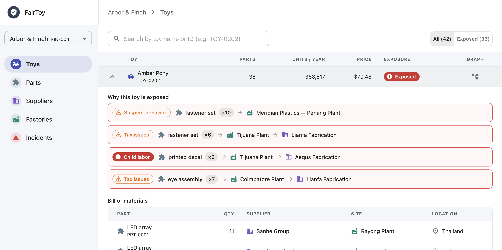
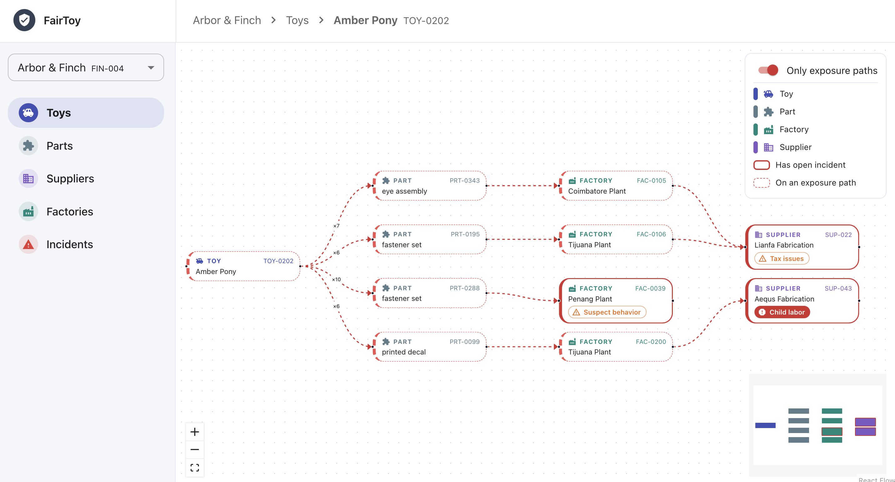

# Supply Chain POC

FairToy is a proof of concept for supply chain risk visibility. Toy brands (finishers) can trace each
product through its parts, the factories that make them and the suppliers that run those factories.
When an incident such as child labor, tax issues or suspect behavior is open against any node in that
chain, every toy that depends on it is flagged as exposed, along with the path that explains why.

**Toys:** each toy shows its exposure status, the incident paths behind it and its bill of materials.



**Supply chain graph:** an interactive graph of a toy's parts, factories and suppliers, with the
exposure paths highlighted.



## Project structure

A monorepo with two projects:

- **`api/`**: Python API. FastAPI serves the endpoints, Django provides the ORM, PostgreSQL runs in Docker.
- **`web/`**: Next.js + React + TypeScript app built with Material UI. It fetches data from the API with SWR.

## Prerequisites

- [just](https://github.com/casey/just) (`brew install just`)
- [uv](https://docs.astral.sh/uv/) (`brew install uv`)
- [Node.js](https://nodejs.org/) 22 or newer
- [Docker](https://www.docker.com/) (running)

## Getting started

```bash
just setup     # install dependencies and create .env files
just api-seed  # load the sample finishers, toys, parts, factories, suppliers and incidents
just dev       # start the database, API and web app
```

Then open:

- Web app: http://localhost:3000. Pick a finisher in the sidebar to browse its toys and their exposure.
- API docs: http://localhost:8000/docs

Press `Ctrl+C` to stop. Postgres keeps running in the background; stop it with `just db-down`.

## Common commands

| Command                   | What it does                                  |
| ------------------------- | --------------------------------------------- |
| `just`                    | List all commands                             |
| `just dev`                | Run the database, API and web app             |
| `just api-dev`            | Run only the API (and database)               |
| `just web-dev`            | Run only the web app                          |
| `just test`               | Run all tests                                 |
| `just lint`               | Lint and typecheck both projects              |
| `just api-makemigrations` | Create Django migrations after model changes  |
| `just api-migrate`        | Apply migrations                              |
| `just api-seed`           | Import the sample data (safe to re-run)       |
| `just db-down`            | Stop the database                             |
| `just db-reset`           | Stop the database and delete its data         |

## Configuration

- `api/.env`: database credentials and allowed CORS origins (created from `api/.env.example`).
- `web/.env.local`: `NEXT_PUBLIC_API_URL`, the API's address (created from `web/.env.example`). az